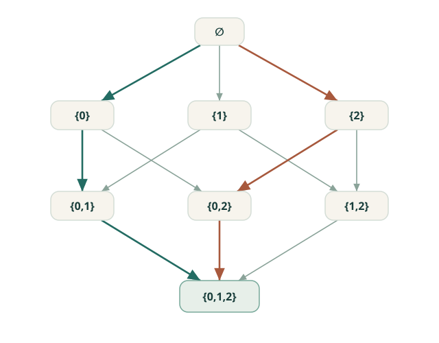
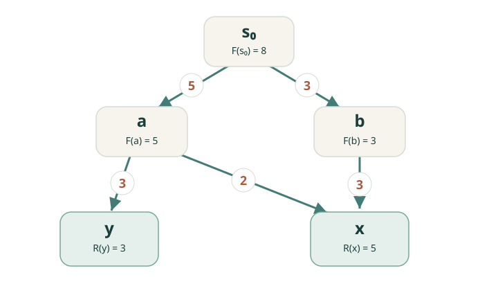

<a id="top"></a>

GENERATIVE FLOW NETWORKS · 从推导到实现

# GFlowNet: 解决生成过程采样问题的热力学视角

在概率建模中，我们经常面对这样的抽样任务：给定一个分布的概率密度函数（pdf）或概率质量函数（pmf），从中产生样本。更困难的情形是，目标分布没有闭式概率密度，只知道一个把简单分布逐步送到它的过程。比如，扩散模型指定一条 Itô SDE，该过程的边缘概率密度满足 Fokker–Planck 方程；flow matching 指定一个动力学 ODE，从而由 push forward measure 推出概率密度满足连续性方程。这时通常写不出可以拿去直接抽样的精确概率密度。

这类任务既重要，做起来也不容易。直接处理目标分布时，常用办法包括 push forward measure，也就是把一个简单分布推前成目标分布（例如由均匀分布得到正态样本）、重要性采样、拒绝采样和 MCMC。另一条常用路径是变分推断：构造一个容易抽样的代理分布，通常取高斯分布，用它近似复杂的真实分布，再从代理分布中抽样。对高维、结构复杂的分布，这些方法各有界限。相关综述很多，这里不再比较。

[GFlowNet](#ref-gfn2021) 是 Emmanuel Bengio 等人在 2021 年提出的生成与抽样框架。它关注的问题是：如果每个完整对象的正奖励 $R(x)$ 都可以计算，怎样从这个奖励定义的分布中采样，使对象被抽到的概率正比于奖励，而不是只生成奖励最大的对象。从热力学的角度看，如果把奖励看成玻尔兹曼因子，采样目标就是正则系综中的玻尔兹曼分布。举一个分子构象采样的例子：人们通常希望采到的构象服从这个分布，能量较低的构象出现得更频繁，而不是只生成能量最低的构象。更抽象地讲，这样的高维复杂分布的抽样在各个生成领域都有广泛应用，而最麻烦的点就在于配分函数难以计算。（Goodfellow、Bengio 与 Courville 在花书第 18 章 Confronting the Partition Function 里把这一点写成未归一化模型的经典困难：合法概率必须把未归一化权重除以配分函数，而配分函数是对全部状态求和或积分；对许多模型，这一步是难解的 [\[6\]](#ref-goodfellow)。这也是为什么GFlowNet提供了一个非常有价值的解决配分函数问题的视角）

GFlowNet 的做法是：把对象的生成拆成一串动作，在生成图上学习一个前向策略，并用反向策略描述同一个对象可以怎样被逐步拆回起点。从热力学的角度看，把奖励写成 $R(x)=e^{-\beta E(x)}$，它就是未归一化的玻尔兹曼权重；未知的归一化常数是配分函数，在选定温度之后，配分函数的对数决定 Helmholtz 自由能。流量守恒把这份权重分配到生成图的各条轨迹上。前向和反向两种描述必须对应同一份轨迹概率，而终点处已知 $R(x)$。这个闭环就成为约束整条生成路径的学习信号。

在这篇文章中，介绍过 GFlowNet 的基本框架和热力学上的思考之后，我们会提供一个生成集合的例子，帮助读者亲手把方法走一遍，从而理解它的精髓。

<a id="problem"></a>

01 / Motivation: 从玻尔兹曼分布中采样

## Motivation: 从玻尔兹曼分布中采样

### 1.1 已知 reward（aka energy），未知配分函数，怎么采样

设完整对象的集合为 $\mathcal X$。每给出一个 $x$，都能计算 $R(x)>0$，目标是

$$
p^\star(x)=\frac{R(x)}{Z},\qquad Z=\sum_{x\in\mathcal X}R(x).
$$

难点通常在于 $\mathcal X$ 太大，无法枚举所有对象再进行归一化。即使知道 $Z$，也未必能够高效地从巨大的离散分布中采样。我们希望付出一次训练成本，学到一个以后可以反复调用的生成器。

### 1.2 用 DAG 把“生成一个对象”变成“一串局部选择”

建立有向无环图 $G=(\mathcal S,\mathcal E)$。一个节点是一个**部分构造的对象**；一条有向边是一次合法构造操作；source $s_0$ 表示尚未开始；终态 $x\in\mathcal X$ 表示完整对象。一条完整轨迹是

$$
\tau=(s_0,s_1,\ldots,s_n=x),\qquad (s_i\to s_{i+1})\in\mathcal E.
$$

以集合为例，从空集出发，每次加入一个尚未选择的元素。集合大小严格增加，所以图无环。同一个无序集合可能由不同顺序构造，例如

$$
\varnothing\to\{0\}\to\{0,1\}\to\{0,1,2\},
\qquad
\varnothing\to\{2\}\to\{0,2\}\to\{0,1,2\}.
$$



青绿色是上述第一条路径，珊瑚色是上述第二条路径。一共有 3! = 6 条通往同一个终态 {0,1,2} 的路径，其他合法路径由灰色表示。

这意味着**对象概率必须把所有到达该对象的轨迹概率加起来**。令 $\mathcal T_x$ 表示所有终点为 $x$ 的完整轨迹，若前向策略为 $P_F$，则

$$
P_F(\tau)=\prod_{i=0}^{n-1}P_F(s_{i+1}\mid s_i),
\qquad
p_F(x)=\sum_{\tau\in\mathcal T_x}P_F(\tau).
$$

一条路径的前向策略容易由 DAG 表达，但把路径概率加总成终态概率可能非常昂贵。这正是引入反向描述的动机：给定 $x$，定义一个归一化的“怎样拆回去”的分布 $P_B(\tau\mid x)$，用它来分配属于 $x$ 的总权重。

### 1.3 构造“闭环”：两种概率描述的自洽

我们期望同一条轨迹可以被两种方式计量：从 source（$s_0$）向前生成；或者先以目标概率选中终点（$s_n=x$），再从终点反向拆解。理想关系是

$$
\underbrace{P_F(\tau)}_{\text{从起点向前}}
=
\underbrace{\frac{R(x)}{Z}P_B(\tau\mid x)}_{\text{先选终点，再向后拆解}}.
$$

接下来的问题就是如何找到一个 conceptual model 来建模 $P_F$、$P_B$ 以及 $Z$，这是第二部分的内容；第三部分再把上述前向过程和反向过程的闭环公式变成一个优化目标。

<a id="flows"></a>

02 / 概率建模

## 概率建模

<a id="thermo"></a>

### 2.1 热力学类比：统计权重沿构造路径分配

之前我们说到，接下来的问题是如何找到一个概念框架来建模 $P_F$、$P_B$ 和 $Z$。热力学给我们提供了一个很好的概念框架。在热力学语境下，GFlowNet 的 flow 可以理解为：**玻尔兹曼统计权重在生成路径上的分配**。流动的是未归一化的概率质量。更一般的说法见[GFlowNet Foundations](#ref-foundations)， 他们把 flow 定义成经过某个节点或某条边的轨迹权重之和。

我们先看热力学背景下的理解。一个完整微观态由 $n$ 个变量组成：

$$
x=(\sigma_1,\ldots,\sigma_n).
$$

它的能量是 $E(x)$，玻尔兹曼权重是 $e^{-\beta E(x)}$。生成 $x$，就是把这 $n$ 个变量逐个确定下来。中间状态 $s$ 只确定了其中 $k$ 个变量，其余 $n-k$ 个还空着：

$$
s=(\sigma_{i_1},\ldots,\sigma_{i_k}),\qquad \{i_1,\ldots,i_k\}\subset\{1,\ldots,n\}.
$$

记 $\Omega(s)$ 为所有与 $s$ 相容的完整微观态，也就是从 $s$ 继续构造还能得到的全部 $x$。终态就是一个完整微观态，它的流量定义为它自己的玻尔兹曼权重：

$$
\boxed{F(x)=e^{-\beta E(x)}.}
$$

变量可以按不同的先后顺序确定，所以同一个 $x$ 通常有多条构造路径。第一部分的集合例子里，通往 $\{0,1,2\}$ 的路径就有 6 条。$x$ 的玻尔兹曼权重只有一份，要分给这些路径。记 $\mathcal T_x$ 为所有通往 $x$ 的路径，路径 $\tau$ 分到的比例就是第一部分的 $P_B(\tau\mid x)$，各条路径的比例加起来是 1。于是每条路径携带的权重是

$$
F(\tau)=e^{-\beta E(x)}\,P_B(\tau\mid x),\qquad \sum_{\tau\in\mathcal T_x}P_B(\tau\mid x)=1.
$$

比例怎么定可以选：可以平均分，也可以让某些路径多拿一些。无论怎么分，通往 $x$ 的所有路径加起来，正好是一份 $e^{-\beta E(x)}$。

节点流量定义为所有经过这个节点的路径所携带的权重之和。把这些路径按终态归类，就得到对微观态的求和：

$$
\boxed{F(s)=\sum_{\tau\ni s}F(\tau)=\sum_{x\in\Omega(s)}e^{-\beta E(x)}\,h_B(s\mid x).}
$$

也就是说，中间节点 $s$ 的流量，是与 $s$ 相容的各个最终微观态的玻尔兹曼权重，各乘上构造该微观态时经过 $s$ 的比例，再求和。这个比例是经过 $s$ 的那些路径分到的比例之和：

$$
h_B(s\mid x)=\sum_{\tau\in\mathcal T_x,\ \tau\ni s}P_B(\tau\mid x).
$$

它在 0 和 1 之间。如果 $x$ 的各条路径平均分，它就是路径条数之比：

$$
h_B(s\mid x)=\frac{\text{经过 }s\text{ 的路径条数}}{\text{通往 }x\text{ 的路径总条数}}.
$$

在集合例子里，通往 $\{0,1,2\}$ 的 6 条路径中有 2 条经过 $\{0\}$：先加入 0，再按两种顺序加入 1 和 2。所以

$$
h_B(\{0\}\mid\{0,1,2\})=\frac{2}{6}=\frac{1}{3}.
$$

$\{0,1,2\}$ 只把自己权重的三分之一记到 $F(\{0\})$ 上，另外三分之二记在 $\{1\}$ 和 $\{2\}$ 上。如果各条路径分到的比例不相等，就把条数换成这些比例，算法不变。

乘上这个比例是为了不重复计数。$\{0\}$、$\{1\}$、$\{2\}$ 都能到达 $\{0,1,2\}$。如果三个节点都记入整份玻尔兹曼权重，这一个微观态就被算了三次。乘上 $h_B(s\mid x)$ 之后，三处合起来正好一份。

把 $h_B(s\mid x)$ 的定义代回去，节点流量就是两层求和：外层对与 $s$ 相容的微观态 $x$，内层对经过 $s$ 到达 $x$ 的路径 $\tau$：

$$
F(s)=\sum_{x\in\Omega(s)}\ \sum_{\substack{\tau\in\mathcal T_x\\ \tau\ni s}}e^{-\beta E(x)}\,P_B(\tau\mid x).
$$

source 的流量可以直接读出来。每条路径都从 $s_0$ 出发，所以对任何 $x$ 都有 $h_B(s_0\mid x)=1$，source 的流量就是配分函数：

$$
F(s_0)=\sum_x e^{-\beta E(x)}=Z.
$$

守恒也从路径上读出来。边流量的定义和节点流量一样，是所有经过这条边的路径所携带的权重之和：

$$
F(s\to s')=\sum_{\tau\ni(s\to s')}F(\tau).
$$

一条经过中间节点 $s$ 的路径，恰好从一条入边进来，也恰好从一条出边离开。把经过 $s$ 的路径按入边分组，或者按出边分组，每条路径都只落在一组里，两种分法加总的都是 $F(s)$。记 $\operatorname{Pa}(s)$ 和 $\operatorname{Ch}(s)$ 为 $s$ 的parent节点集合和child节点集合，就有

$$
\sum_{u\in\operatorname{Pa}(s)}F(u\to s)=F(s)=\sum_{s'\in\operatorname{Ch}(s)}F(s\to s').
$$

流入等于流出。权重记在路径上，路径在中间节点既不会断掉，也不会变成两条，所以中间节点不产生权重，也不丢失权重。

| 节点 | 已知的信息 | flow 的热力学含义 |
| --- | --- | --- |
| source | 尚未确定任何变量 | $F(s_0)=Z=\sum_x e^{-\beta E(x)}$ |
| 中间节点 | 已确定其中 $k$ 个变量 | $\displaystyle F(s)=\sum_{x\in\Omega(s)}\ \sum_{\substack{\tau\in\mathcal T_x\\ \tau\ni s}}e^{-\beta E(x)}\,P_B(\tau\mid x)$ |
| 终态 | 全部变量已确定 | $F(x)=e^{-\beta E(x)}$ |

有了节点流量，就可以给每个节点定义自由能。为了和 flow 的符号 $F$ 分开，自由能记作 $\mathcal{A}$：

$$
\boxed{\mathcal{A}(s)=-k_BT\log F(s).}
$$

这和热力学里的 $\mathcal{A}=-k_BT\log Z$ 是同一个式子，只是把配分函数换成了节点流量。流量越大，自由能越低。

例如，设有 $M$ 个微观态把全部权重都记在 $s$ 上，能量都是 $\varepsilon$，那么

$$
F(s)=Me^{-\beta\varepsilon},\qquad\mathcal{A}(s)=\varepsilon-k_BT\log M.
$$

于是

$$
U_s=\varepsilon,\qquad S_s=k_B\log M,\qquad\mathcal{A}(s)=U_s-TS_s.
$$

**flow 大，可以来自较低的能量，也可以来自更多可实现的微观态。**它反映的是经过这里的统计权重，不能只看某一个最优终态的能量。

站在一个节点上，下一步怎么选，就是把这里的流量分给各条出边。分到某一条边的比例，就是这一步的概率。两个节点的自由能只比较各自的总流量：流量大，自由能低。一条边占多少，看的是这条边分到的那一份。采样目标仍是玻尔兹曼分布，全体系的自由能就是 source 上的这个量：

$$
Z=\sum_x e^{-\beta E(x)},\qquad p^\star(x)=e^{-\beta[E(x)-\mathcal{A}]},\qquad\mathcal{A}=-\beta^{-1}\log Z=-k_BT\log Z.
$$

中间节点的自由能用的就是上面定义的 $F(s)$。里面既有微观态的玻尔兹曼权重，也有这些权重在各条构造路径上的比例 $h_B(s\mid x)$。

### 2.2 由类比定义 $F(s)$、边 flow F(s-&gt;s') 和守恒关系

前面的热力学类比已经说明，流量分配的是统计权重，现在再总结一下通用说法。我们先把符号定下来。记 $\operatorname{Pa}(s)$ 为 $s$ 的parent节点集合，$\operatorname{Ch}(s)$ 为child节点集合。边流量是沿这一步送出的那一份未归一化权重 $F(s\to s')$。后面的比值和对数只在正流量边上讨论，用到的节点 flow 也都为正；零流量边可以移出这个支持。

中间节点不积累权重，流入等于流出。这个共同值记为 $F(s)$：

$$
F(s)
=\sum_{u\in\operatorname{Pa}(s)}F(u\to s)
=\sum_{v\in\operatorname{Ch}(s)}F(s\to v).
\tag{1}
$$

本文采用如下边界约定：

| 节点类型 | flow 定义或约束 | 含义 |
| --- | --- | --- |
| source $s_0$ | $F(s_0)=\sum_v F(s_0\to v)$ | 外部注入图的总流量 |
| 中间节点 $s$ | 流入 $=F(s)=$ 流出 | 不积累、不产生、不损失 |
| 终态 / drain $x$ | $F(x)=\sum_u F(u\to x)=R(x)$ | 流量从此处流出整个系统 |

### 2.3 为什么 source 的 flow 必须等于 $Z$？

对所有节点的“流出减流入”求和。每条内部边恰好在起点被加一次、在终点被减一次，因此总和为零。中间节点自身的净流量也是零，剩下 source 和各个 drain：

$$
0=\sum_{s\in\mathcal S}
\left[\sum_v F(s\to v)-\sum_u F(u\to s)\right]
=F(s_0)-\sum_{x\in\mathcal X}F(x).
$$

再代入终态边界条件 $F(x)=R(x)$，得到

$$
\boxed{F(s_0)=\sum_x R(x)=Z.}
\tag{2}
$$

因此，配分函数 $Z$ 就是 source 供给全部终态的总流量。把守恒从 source 加到终态，中间节点只是转手，每一份终态权重都从 source 出发，所以 source 注入的就是配分函数。

### 2.4 前向策略：用节点 flow 归一化出边

站在非终态 $s$ 上，下一步把权重送到哪里，就把节点流量按出边拆开。前向策略就是这一步送出的流量，占节点流量的比例：

$$
P_F(s'\mid s):=\frac{F(s\to s')}{F(s)}.
\tag{3}
$$

为什么它是一个合法概率？因为每个分子非负，而且

$$
\sum_{s'\in\operatorname{Ch}(s)}P_F(s'\mid s)
=\frac{\sum_{s'}F(s\to s')}{F(s)}
=\frac{F(s)}{F(s)}=1.
$$

**求和指标不要和条件端弄反。**前向概率是固定parent节点之后，对child节点归一化。一般并不成立 $\sum_u P_F(s\mid u)=1$。对parent节点归一化的是后面由贝叶斯公式得到的反向概率：$\sum_u P_B(u\mid s)=1$。每个条件概率的求和变量都必须与条件端区分开。

<a id="occupancy"></a>

### 2.5 先说清楚 $P(s)$：它是被访问的概率

贝叶斯公式要用“轨迹经过某一条边”的概率，而经过一条边，意味着它的parent节点被访问过。先把访问概率写清楚。从 source 按 $P_F$ 采样完整轨迹。一个节点被访问到的概率定义为

$$
\pi(s):=\Pr_{\,\tau\sim P_F}(s\text{ 被这条轨迹访问}).
$$

由于图无环，一条轨迹至多访问每个节点一次。所有轨迹都从 $s_0$ 出发，所以 $\pi(s_0)=1$。对其他节点，轨迹必然从某一个直接parent节点进入它。按进入它的最后一条边分类，事件互斥且穷尽，因此

$$
\pi(s')=\sum_{s\in\operatorname{Pa}(s')}\pi(s)\,P_F(s'\mid s).
\tag{4}
$$

我们要证明 $\pi(s)=F(s)/Z$。这不是定义，而是沿拓扑序归纳得到的结论：

1. **起点。**$\pi(s_0)=1=F(s_0)/Z$，由式 (2) 得到。

2. **归纳假设。**设 $s'$ 的所有parent节点都已经满足 $\pi(s)=F(s)/Z$。

3. **推进一步。**把parent节点的表达式与式 (3) 代入式 (4)：

$$
\begin{aligned}
\pi(s')
&=\sum_{s\in\operatorname{Pa}(s')}
\frac{F(s)}{Z}\frac{F(s\to s')}{F(s)}\\
&=\frac1Z\sum_{s\in\operatorname{Pa}(s')}F(s\to s')\\
&=\frac{F(s')}{Z}.
\end{aligned}
$$

这完成了对所有节点的证明。特别是对终态，访问它就意味着最终生成它，因此

$$
\boxed{\pi(s)=\frac{F(s)}{Z},\qquad p_F(x)=\pi(x)=\frac{R(x)}{Z}.}
\tag{5}
$$

注意 $\pi(s)$ 是一组**访问事件的概率**，并不是在全体节点上抽取一个节点的概率质量函数：一条轨迹会访问多个节点，这些事件不互斥。若轨迹包含 $N(\tau)$ 条边，则

$$
\sum_{s\in\mathcal S}\pi(s)=\mathbb E_{P_F}[N(\tau)+1].
$$

这个等式的推导只有一步。把访问概率写成指示函数的期望，$\pi(s)=\mathbb E_{P_F}\bigl[\mathbf 1[s\in\tau]\bigr]$，再交换求和与期望：

$$
\begin{aligned}
\sum_{s\in\mathcal S}\pi(s)
&=\sum_{s\in\mathcal S}\mathbb E_{P_F}\bigl[\mathbf 1[s\in\tau]\bigr]
=\mathbb E_{P_F}\Bigl[\sum_{s\in\mathcal S}\mathbf 1[s\in\tau]\Bigr]\\
&=\mathbb E_{P_F}[N(\tau)+1].
\end{aligned}
$$

方括号里的和，数的是这条轨迹访问了多少个节点。图无环，一条有 $N(\tau)$ 条边的轨迹正好访问 $N(\tau)+1$ 个不同的节点。

在后面的集合例子里，每条轨迹都从空集出发，每步加入一个元素，固定 3 步后结束，所以 $N(\tau)=3$。每条轨迹访问 4 个节点：空集、一个单元素集合、一个二元素集合、一个三元素集合。于是

$$
\sum_{s\in\mathcal S}\pi(s)=\mathbb E_{P_F}[3+1]=4.
$$

也可以按层来数。把含 $k$ 个元素的集合叫第 $k$ 层，$k=0,1,2,3$。每条轨迹在每一层恰好访问一个节点，所以同一层里“访问某个节点”这些事件互斥，而且总有一个发生，它们的概率加起来是 1。四层一共是 4：

$$
\sum_{|s|=k}\pi(s)=1\quad(k=0,1,2,3),\qquad \sum_{s\in\mathcal S}\pi(s)=\sum_{k=0}^{3}\ \sum_{|s|=k}\pi(s)=4.
$$

两边乘上 $Z$，就是每一层的节点流量加起来都等于配分函数：

$$
\sum_{|s|=k}F(s)=Z\quad(k=0,1,2,3).
$$

在一般 DAG 中，同一个节点甚至可能被不同长度的路径到达，这时不一定能这样分层，但使用“是否访问过”的定义仍然有效。

**为什么这个归一化等式无法决定 $P(s)$？**

$P(s)=\sum_{s'}P_F(s'\mid s)P(s)$ 只是 $P(s)=P(s)$，因为条件概率已经归一化了。它检查的是从 $s$ 出发如何分配质量，却没有说明质量怎样到达 $s$。真正决定访问概率的是“固定当前节点、对parent节点求和”的递推式 (4)，加上 $\pi(s_0)=1$。

**如果一定想在“全体节点”上定义一个归一化分布呢？**

可以定义 $q_{\rm node}(s)=F(s)/C$，其中 $C=\sum_{u\in\mathcal S}F(u)=Z\,\mathbb E[N+1]$。它确实是节点上的概率分布，且概率比仍等于 flow 比。但 $q_{\rm node}(s_0)=Z/C$，通常不等于 1。

因此 $q_{\rm node}(s_0)\prod_iP_F(s_{i+1}\mid s_i)$ 对所有完整轨迹求和得到的是 $q_{\rm node}(s_0)$，不是 1。它是一个缩放后的轨迹权重，不能直接称为归一化的完整轨迹概率。本篇统一使用 $\pi(s)$ 表示访问概率，避免混淆这两个对象。

### 2.6 反向一步：由 Bayes 得到细致平衡

刚才我们讨论了半天 $\pi(s)$。有了 $\pi(s)$，我们终于可以考虑反向的 $P_B$ 在这个 $F(\cdot)$ 和 $F(\cdot\to\cdot)$ 的框架下如何定义了。考虑相邻的 $s\to s'$。定义 $E_{s\to s'}$ 为“采样轨迹经过这条边”的事件。按前向生成过程：

$$
\Pr(E_{s\to s'})=\pi(s)P_F(s'\mid s).
$$

反向单步概率的含义是：**已知轨迹到达了 $s'$，它刚才是从哪个直接parent节点进入的？**因此

$$
\begin{aligned}
P_B(s\mid s')
&:=\Pr(\text{直接前驱是 }s\mid s'\text{ 被访问})\\
&=\frac{\Pr(E_{s\to s'})}{\pi(s')}\\
&=\frac{\pi(s)P_F(s'\mid s)}{\pi(s')}\\
&=\frac{[F(s)/Z]\,[F(s\to s')/F(s)]}{F(s')/Z}\\
&=\boxed{\frac{F(s\to s')}{F(s')}}.
\end{aligned}
\tag{6}
$$

注意这里的 Bayes 关系针对**相邻一步**，对同一个 child 的所有parent节点求和：

$$
\sum_{s\in\operatorname{Pa}(s')}P_B(s\mid s')
=\frac{\sum_s F(s\to s')}{F(s')}=1.
$$

现在式 (3) 与式 (6) 共同给出

$$
\boxed{F(s)P_F(s'\mid s)=F(s\to s')=F(s')P_B(s\mid s').}
\tag{7}
$$

这就是 GFlowNet 的 **detailed balance（细致平衡）**。它说的是，同一条边上的流量有两种算法。从parent节点 $s$ 看，是 $s$ 的流量乘上向前走到 $s'$ 的概率；从child节点 $s'$ 看，是 $s'$ 的流量乘上向后退回 $s$ 的概率。两种算法数的是同一份流量，所以相等。$P_F$ 把 $s$ 的流量分给它的各个child节点，$P_B$ 把 $s'$ 的流量分给它的各个parent节点。

### 2.7 多条构造路径时，中间 flow 还要分配权重

节点上的自由能就是 $\mathcal{A}(s)=-\beta^{-1}\log F(s)$。式 (7) 就写成

$$
\frac{P_F(s'\mid s)}{P_B(s\mid s')}=\frac{F(s')}{F(s)}=e^{-\beta\bigl(\mathcal{A}(s')-\mathcal{A}(s)\bigr)}.
$$

式 (7) 把前向、反向概率比写成两端 flow 的对数差，也就是自由能差。**中间节点的 flow 并不是它能到达的终态奖励之和**：同一个终态可以有多条构造路径，若把全部玻尔兹曼权重算进每一个经过的节点，就会重复计数。路径分配决定 $F(s)$。若 $h_B(s\mid x)$ 表示从 $x$ 反向采样时经过 $s$ 的概率，则

$$
F(s)=\sum_x R(x)\,h_B(s\mid x).
$$

每个终态的权重按构造路径分配。因为奖励就是玻尔兹曼因子，这就是 2.1 里定义节点流量的那个加权和。对 source，有 $h_B(s_0\mid x)=1$，于是再次得到 $F(s_0)=Z$。中间节点则带有由路径分配决定的权重。

以集合生成为例。均匀地反向删除元素时，终态 {0,1,2} 回到单元素集合，留下 {0} 的概率是 1/3。这个终态贡献的只有

$$
\frac13 e^{-\beta E(\{0,1,2\})}.
$$

**source 的流量有明确的配分函数意义；一般 DAG 中的中间 flow，还包含人为选择的构造路径分配。**对它取 $-k_BT\log F(s)$，仍然得到一个自由能形式的量，但它未必就是仅由物理约束决定的标准自由能。

<a id="tb-derivation"></a>

### 2.8 沿轨迹把细致平衡乘起来

取完整轨迹 $\tau=(s_0,\ldots,s_n=x)$。对每条边，将式 (7) 改写为

$$
\frac{P_F(s_{i+1}\mid s_i)}{P_B(s_i\mid s_{i+1})}
=\frac{F(s_{i+1})}{F(s_i)}.
$$

把 $i=0,\ldots,n-1$ 的等式相乘，右边所有中间节点 flow 抵消：

$$
\begin{aligned}
\frac{\prod_{i=0}^{n-1}P_F(s_{i+1}\mid s_i)}
     {\prod_{i=0}^{n-1}P_B(s_i\mid s_{i+1})}
&=\frac{F(s_1)}{F(s_0)}
  \frac{F(s_2)}{F(s_1)}
  \cdots
  \frac{F(x)}{F(s_{n-1})}\\
&=\frac{F(x)}{F(s_0)}
=\frac{R(x)}{Z}.
\end{aligned}
$$

中间流量相消之后，得到 **trajectory balance（TB，轨迹平衡）**。一条轨迹上的守恒收成一个等式：

$$
\boxed{Z\prod_{i=0}^{n-1}P_F(s_{i+1}\mid s_i)
=R(x)\prod_{i=0}^{n-1}P_B(s_i\mid s_{i+1}).}
\tag{8}
$$

左边是从 source 向前走完这条轨迹，右边是先按目标分布选中终态、再按反向策略拆回去。两种条件概率写成：

$$
P_F(\tau)=\prod_iP_F(s_{i+1}\mid s_i),\qquad
P_B(\tau\mid x)=\prod_iP_B(s_i\mid s_{i+1}).
$$

从 source 出发的初始概率是 1，所以前向完整轨迹概率就是 $P_F(\tau)$。反向完整轨迹分布还需要一个终点分布；在理想解处，它是

$$
P_{\rm backward}(\tau)
=p^\star(x)P_B(\tau\mid x)
=\frac{R(x)}{Z}P_B(\tau\mid x)
=P_F(\tau).
$$

**这些等式是同一份守恒 flow 的两种读法。**如果 $P_F$、$P_B$ 都由式 (3)、(6) 从同一个守恒 flow 导出，那么 DB 与 TB 自然成立。但分别初始化的两个神经网络，即使各自 softmax 后都归一化，也未必满足 TB。第三部分要把这个差距变成可以下降的目标。

### 2.9 用一个 5 节点图的例子解释以上概念

用数字把这本账走一遍。设 $R(x)=5,\ R(y)=3$。其中 $x$ 有两条构造路径，$y$ 只有一条。图中数字是边 flow；终态奖励要由到达它的路径共同分担：



中间节点流入等于流出。同一个终态的奖励可以分到不同路径上，路径条数本身不是额外奖励。

节点 flow 为 $F(s_0)=8,\ F(a)=5,\ F(b)=3,\ F(x)=5,\ F(y)=3$。以路径 $s_0\to a\to x$ 为例：

$$
P_F(\tau)=\frac58\frac25=\frac14,\qquad
P_B(\tau\mid x)=\frac25\cdot1=\frac25,
$$

$$
ZP_F(\tau)=8\cdot\frac14=2
=5\cdot\frac25=R(x)P_B(\tau\mid x).
$$

| 完整路径 | $P_F(\tau)$ | $P_B(\tau\mid\text{终点})$ | TB 两边的 flow |
| --- | --- | --- | --- |
| $s_0\to a\to x$ | $(5/8)(2/5)=1/4$ | $2/5$ | $2$ |
| $s_0\to b\to x$ | $(3/8)(1)=3/8$ | $3/5$ | $3$ |
| $s_0\to a\to y$ | $(5/8)(3/5)=3/8$ | $1$ | $3$ |

把到达同一终态的路径相加：$p_F(x)=1/4+3/8=5/8$，而 $p_F(y)=3/8$。反向概率把属于 $x$ 的 5 单位 flow 分到了两条路径上，比例为 $2/5$ 与 $3/5$。**路径数量不会被误当成额外的终态奖励。**

<a id="learning"></a>

03 / 优化目标和参数化

## 优化目标和参数化

### 3.1 推导与训练，是两个不同阶段

上一部分讨论的是：假如已经有一个守恒、终态匹配奖励的 flow，会得到怎样的概率关系。真正训练时，我们并不知道每条边应该分到多少 flow，也无法直接算出 $Z$。所以把推导得到的 TB 等式用作一致性约束。

本篇主实现使用三组可训练量：

| 数学对象 | 参数化方式 | NNX 中对应什么 |
| --- | --- | --- |
| $P_F^\theta(\cdot\mid s)$ | 网络输出前向动作 logits，在合法添加动作上 softmax | `model.forward` 的权重与偏置 |
| $P_B^\phi(\cdot\mid s')$ | 另一网络输出反向动作 logits，在合法删除动作上 softmax | `model.backward` 的权重与偏置 |
| $\widehat Z=e^z$ | 一个无约束实标量 $z=\log\widehat Z$ | `model.log_z = nnx.Param(...)` |

奖励函数 $R(x)$、DAG 的规则和合法动作 mask 都固定。**本篇的 TB 实现不额外建立一个输出 $F(s)$ 的网络，也不逐条参数化边 flow。**中间 flow 在推导 TB 时已经相消；计算损失只需要两种策略、一个标量和终态奖励。

若固定反向策略，例如集合例子中的均匀删除，就只训练 $(\theta,z)$。若把它也学习，则训练 $(\theta,\phi,z)$。两种选择都可以满足同一个终态目标；反向策略控制的是终态质量如何分配到不同的构造路径。

**初始化时，反向网络只是一个待学习的条件分布。**它并不自动等于当前前向网络的 Bayes 反向条件分布。两个网络各自归一化，只保证它们各自合法；TB 才约束它们是否对应同一个、终态满足 $R$ 的 flow。

### 3.2 把乘积等式改写成 log residual

对式 (8) 两边取对数，理想关系是

$$
z+\sum_{i=0}^{n-1}\log P_F^\theta(s_{i+1}\mid s_i)
=\log R(x)+\sum_{i=0}^{n-1}\log P_B^\phi(s_i\mid s_{i+1}).
$$

把右边移到左边，定义残差

$$
r_{\theta,\phi,z}(\tau)
=z+\sum_i\log P_F^\theta(s_{i+1}\mid s_i)
-\log R(x)-\sum_i\log P_B^\phi(s_i\mid s_{i+1}).
\tag{9}
$$

写成一行更容易看清它的含义：

$$
r(\tau)=\log
\frac{\widehat Z\,P_F^\theta(\tau)}
     {R(x)\,P_B^\phi(\tau\mid x)}.
$$

所以 $r=0$ 表示两种轨迹 flow 相同；$r>0$ 表示当前前向一侧的 flow 较大；$r<0$ 表示反向一侧较大。取对数既避免长轨迹概率连乘带来的数值下溢，也把乘法比例误差变成可比较的加法误差。

对一个用于训练的轨迹分布 $\mu$，定义

$$
\boxed{\mathcal L_{\rm TB}(\theta,\phi,z;\mu)
=\mathbb E_{\tau\sim\mu}\left[r_{\theta,\phi,z}(\tau)^2\right].}
\tag{10}
$$

实际用一个 batch 的轨迹近似这个期望：

$$
\widehat{\mathcal L}_{\rm TB}
=\frac1B\sum_{b=1}^B r_{\theta,\phi,z}(\tau^{(b)})^2.
$$

更新的变量是 $\theta,\phi,z$，而不是 $R$，也不是已经采到的离散动作。对单条轨迹，梯度的结构很直接：

$$
\begin{aligned}
\nabla_\theta r^2&=2r\sum_i\nabla_\theta\log P_F^\theta(s_{i+1}\mid s_i),\\
\nabla_\phi r^2&=-2r\sum_i\nabla_\phi\log P_B^\phi(s_i\mid s_{i+1}),\\
\partial_z r^2&=2r.
\end{aligned}
$$

这三个更新共同调整前向路径分配、反向路径分配和整体尺度。固定 $P_B$ 时，第二行没有待更新参数。

### 3.3 轨迹从哪里来？采样策略与损失里的策略要分开

我们尚未拥有来自 $R/Z$ 的样本，所以先用当前前向网络自己生成轨迹。为使早期训练覆盖更多路径，示例的行为策略混入 20% 的合法动作均匀分布：

$$
b_{\bar\theta}(a\mid s)
=(1-\varepsilon)P_F^{\bar\theta}(a\mid s)
+\varepsilon\,u(a\mid s),\qquad
\varepsilon=0.2.
$$

这里 $\bar\theta$ 表示采集这批数据时的参数；整条轨迹的行为分布为 $\mu_{\bar\theta}(\tau)=\prod_i b_{\bar\theta}(a_i\mid s_i)$。一轮训练按以下顺序进行：

1. 用当前模型与随机 key，从全零 state 采出一批完整动作序列。

2. 把这些动作视为固定训练数据，重新运行模型，计算它们在当前 $P_F^\theta$ 与 $P_B^\phi$ 下的 log 概率。

3. 在终态计算 $\log R(x)$，构成残差和平方损失。

4. 对模型参数求梯度，更新后重新采下一批数据。

**损失里使用的是 $P_F^\theta$，不是用于探索的混合策略 $b$。**行为策略只决定这轮检查哪些轨迹；TB 等式约束的仍是我们希望部署的生成策略。训练完成后，把 $\varepsilon$ 设为 0，使用纯 $P_F^\theta$ 生成。

在本轮微分时，$\mu$ 和离散动作均固定，因此没有对 categorical 采样操作求导，也不需要一个从 $x$ 到动作的可微 reward。我们只需要可计算的正权重。这是对固定批次的一致性损失求梯度。

**这里有没有漏掉“采样分布也依赖参数”的梯度？**

若把目标严格定义为 $\mathbb E_{\tau\sim\mu_\theta}[r_\theta(\tau)^2]$，并对其中所有参数依赖同时求导，就还会出现 $\mathbb E[r_\theta^2\nabla_\theta\log\mu_\theta]$ 这一项。本文的更新不声称计算这个总导数，而是在每一轮把行为分布 $\mu_{\bar\theta}$ 固定下来，对 $\mathbb E_{\mu_{\bar\theta}}[r_{\theta,\phi,z}^2]$ 中的残差求导。

只要训练分布对所有有效轨迹有支持，逐轨迹的共同零点不受正权重选择影响，所以这种 TB 回归不必为了零点正确性进行 importance weighting。但有限训练时，不同的数据覆盖和权重会影响收敛、方差和最终误差，不能把它们视作完全等效。

### 3.4 最关键的反向证明：TB 成立，就一定采到 $R/Z$ 吗？

要回答这个问题，不能预先假设模型的终态概率已经正确。现在只假设：两种单步策略各自归一化；所有反向轨迹都在有限步内到达唯一 source；并且每条完整轨迹的 TB 残差都为零。记当前学到的正标量为 $\widehat Z=e^z$，先不假定它等于真实 $Z$。

**第一步：对固定终态 $x$，把 TB 对所有到达它的轨迹求和。**

$$
\begin{aligned}
\widehat Z\,p_F^\theta(x)
&=\widehat Z\sum_{\tau\in\mathcal T_x}P_F^\theta(\tau)\\
&=R(x)\sum_{\tau\in\mathcal T_x}P_B^\phi(\tau\mid x).
\end{aligned}
$$

**第二步：反向路径概率之和是 1。**从固定 $x$ 出发，每一步都在合法parent节点中按归一化概率选择；有限 DAG、唯一根节点和可达性保证这些路径最终全部到达 $s_0$。因此

$$
\sum_{\tau\in\mathcal T_x}P_B^\phi(\tau\mid x)=1,
\qquad
\widehat Z\,p_F^\theta(x)=R(x).
$$

**第三步：再对所有终态求和，确定 $\widehat Z$。**前向过程也是归一化、必然结束的生成过程，所以

$$
\widehat Z
=\widehat Z\sum_x p_F^\theta(x)
=\sum_xR(x)=Z.
$$

最后代回去，得到

$$
\boxed{\widehat Z=Z,\qquad p_F^\theta(x)=R(x)/Z.}
\tag{11}
$$

这说明学习目标不是只在形式上像一个概率一致性条件：它足以推出想要的终态分布。与此同时，这个证明依赖**所有有效轨迹**上的 TB 成立。有限 batch 上较小的训练 loss，本身不能保证尚未探索的模式也已经正确。

### 3.5 没有显式预测 $F(s)$，flow 去了哪里？

给定任何归一化的 $P_F^\theta$ 和正标量 $\widehat Z$，它们都隐式定义了一组守恒 flow。记当前前向轨迹的访问概率为 $\pi_\theta(s)$，就有

$$
F_\theta(s)=\widehat Z\,\pi_\theta(s),\qquad
F_\theta(s\to s')=\widehat Z\,\pi_\theta(s)P_F^\theta(s'\mid s).
$$

困难在于：$\pi_\theta(s)$ 可能需要对大量前缀路径求和。TB 的计算绕开了这个显式求和。训练前，这组隐式 flow 的终态值一般不等于 $R(x)$，学习的 $P_B^\phi$ 也可能与它不一致；达到式 (11) 的理想解时，这两处不一致一起被消除。

**整条学习逻辑：**自洽 flow ⇒ DB ⇒ TB；再把 TB 当作逐轨迹约束训练，反过来得到终态奖励匹配。推导给出约束，参数化给出可优化的自由度。

<a id="implementation"></a>

04 / Flax.nnx 逐步实现

## Flax.nnx 逐步实现

主文件是 `gflownet_nnx_tutorial.py`。下面的核心代码块直接从这个文件抽取；完整实现以仓库中的 `gflownet_nnx_tutorial.py` 与 `utility.py` 为准。环境规则、数学符号和张量形状保持一一对应。

### 4.1 state、action 和终态是什么？

从元素全集 $\{0,1,2,3,4\}$ 中选 3 个，顺序不重要。令 state 是长度为 5 的 bit 向量：

$$
s=(b_0,b_1,b_2,b_3,b_4),\qquad b_j\in\{0,1\}.
$$

$b_j=1$ 表示元素 $j$ 已经被选中。source 是全零向量；action $a=j$ 表示加入元素 $j$；只有 $b_j=0$ 时才能加入。加入后，child 是 $s'=s+e_j$。当 $\sum_jb_j=3$ 时，轨迹结束。

| 对象 | 一个具体例子 | 代码中的 batch 形状 |
| --- | --- | --- |
| state | `[1, 0, 1, 0, 0]` 表示 $\{0,2\}$ | `[B, 5]`，float32 |
| forward action | `3` 表示加入元素 3 | `[B]`，整数 |
| child | `[1, 0, 1, 1, 0]` 表示 $\{0,2,3\}$ | `[B, 5]` |
| backward action | 删除元素 3，回到原来的 state | 同一个整数索引 |
| 完整动作序列 | `[0, 2, 3]` | `[B, 3]` |

图共有 $1+5+10+10=26$ 个状态，10 个终态和 $5\cdot4\cdot3=60$ 条完整轨迹。每个终态恰好有 $3!=6$ 条生成路径。这个规模足够小，训练之后可以精确检查；训练时仍只用采到的轨迹。

bit 向量会把不同添加顺序合并到同一个 state。因此网络只需要看到当前集合，无须记住此前顺序。这里动作与后继状态一一对应，所以 $P_F(a=j\mid s)$ 与 $P_F(s+e_j\mid s)$ 是同一个概率。

### 4.2 定义一个有两个峰的奖励

令偏好的两个集合为 $A=\{0,1,2\}$、$B=\{2,3,4\}$。对两个同样大小的集合，定义

$$
d(s,A)=\frac12\sum_{j=0}^4|b_j-A_j|,
\qquad
R(s)=e^{-2.5d(s,A)}+e^{-2.5d(s,B)}.
$$

一半 Hamming 距离等于需要替换的元素数。每个偏好集合都是一个峰；其他集合也有正的奖励。实现直接计算 log reward，避免先算很小的指数再取对数：

```python
def log_reward(bits: jax.Array) -> jax.Array:
    """返回终态 log R；两个偏好的集合分别是 {0,1,2}、{2,3,4}。"""
    mode_a = jnp.array([1, 1, 1, 0, 0], dtype=jnp.float32)
    mode_b = jnp.array([0, 0, 1, 1, 1], dtype=jnp.float32)
    distance_a = 0.5 * jnp.abs(bits - mode_a).sum(axis=-1)
    distance_b = 0.5 * jnp.abs(bits - mode_b).sum(axis=-1)
    return jnp.logaddexp(-2.5 * distance_a, -2.5 * distance_b)
```

`jnp.logaddexp(u, v)` 稳定地计算 $\log(e^u+e^v)$。因为训练只在终态调用 reward，中间 state 不需要定义一个奖励标签。

这个玩具环境能手算归一化常数：

$$
Z=2+12e^{-2.5}+6e^{-5}\approx3.02545,\qquad
\log Z\approx1.10706.
$$

但这个数**不传给模型，也不参与训练损失**；它只在训练结束后的诊断中出现。

<a id="mask"></a>

### 4.3 masked softmax 到底做了什么？

网络首先输出 5 个任意实数 $\ell_j(s)$，叫作 logits。前向动作的合法集合是 $\mathcal A_F(s)=\{j:b_j=0\}$。定义

$$
\widetilde\ell_j(s)=
\begin{cases}
\ell_j(s),&j\in\mathcal A_F(s),\\
-\infty,&j\notin\mathcal A_F(s),
\end{cases}
\qquad
P_F(j\mid s)
=\frac{\exp\widetilde\ell_j(s)}
{\sum_k\exp\widetilde\ell_k(s)}.
$$

非法动作的 $e^{-\infty}=0$，所以它们的概率严格为零；合法动作的概率总和为 1。对于合法动作，log 概率就是

$$
\log P_F(j\mid s)=\ell_j(s)-\operatorname{logsumexp}_{k\in\mathcal A_F(s)}\ell_k(s).
$$

例如 state 为 `[1,0,1,0,0]`，网络 logits 为 `[2,1,0,3,-1]`。mask 后只剩下元素 1、3、4 可选：

| 元素 $j$ | 0 | 1 | 2 | 3 | 4 |
| --- | --- | --- | --- | --- | --- |
| mask 后 logit | $-\infty$ | 1 | $-\infty$ | 3 | −1 |
| softmax 概率 | 0 | 0.1173 | 0 | 0.8668 | 0.0159 |

```python
def masked_log_softmax(logits: jax.Array, legal: jax.Array) -> jax.Array:
    """只在合法动作上归一化；调用方保证每行至少一个合法动作。"""
    masked_logits = jnp.where(legal, logits, -jnp.inf)
    return jax.nn.log_softmax(masked_logits, axis=-1)
```

mask 是环境规则，不是待训练参数。前向用 `state == 0`，反向用 `child == 1`。注意本例每一步调用时都至少有一个合法动作：不在终态上继续前向采样，也不在空集上调用反向策略。**如果一整行 logits 都是 $-\infty$，softmax 没有合法归一化分母，会产生 NaN。**

原样例用 `-1e9` 近似 $-\infty$；本版使用真正的 `-jnp.inf`，并明确上述调用条件。计算 loss 时只索引采到的合法动作，不执行含有 $0\times(-\infty)$ 的全动作加权运算。

### 4.4 两个策略网络，加一个标量

两个 MLP 都接收同样的 5 维 state，输出 5 个 logits，但参数各自独立。前向的 5 个输出表示“加入谁”；反向的 5 个输出表示“删除谁”。网络的输出没有直接被称为 flow，它们经 mask 和 softmax 后才成为条件概率。

```python
class PolicyMLP(nnx.Module):
    """输入 5 维 bit state，输出 5 个动作的未归一化 logits。"""

    def __init__(self, *, rngs: nnx.Rngs, width: int = 64):
        """建立两个隐藏层；nnx.Linear 的权重和偏置都是 nnx.Param。"""
        self.fc1 = nnx.Linear(N_ITEMS, width, rngs=rngs)
        self.fc2 = nnx.Linear(width, width, rngs=rngs)
        self.out = nnx.Linear(width, N_ITEMS, rngs=rngs)

    def __call__(self, state: jax.Array) -> jax.Array:
        """对单个 state 或 [batch, 5] states 计算 logits。"""
        h = jax.nn.silu(self.fc1(state))
        h = jax.nn.silu(self.fc2(h))
        return self.out(h)
```

```python
class SetGFlowNet(nnx.Module):
    """分别参数化 P_F、可选的 P_B，以及标量 z = log Z。"""

    def __init__(self, *, rngs: nnx.Rngs, learn_backward: bool = True):
        """uniform 模式不建立反向网络，因此没有未使用的反向参数。"""
        self.forward = PolicyMLP(rngs=rngs)
        self.backward = PolicyMLP(rngs=rngs) if learn_backward else None
        self.log_z = nnx.Param(jnp.array(0.0, dtype=jnp.float32))

    def forward_log_probs(self, state: jax.Array) -> jax.Array:
        """前向添加一个未选元素；只在 |state| < 3 时调用。"""
        return masked_log_softmax(self.forward(state), state == 0)

    def backward_log_probs(self, child: jax.Array) -> jax.Array:
        """从 child 删除一个已有元素；不能在空集 source 上调用。"""
        logits = self.backward(child) if self.backward is not None else jnp.zeros_like(child)
        return masked_log_softmax(logits, child == 1)
```

所有 `nnx.Linear` 的权重和偏置都是 `nnx.Param`；`log_z` 也显式声明为 `nnx.Param`。这样优化器的参数筛选就和数学中的 $(\theta,\phi,z)$ 一致。用 $\log\widehat Z$ 而非 $\widehat Z$ 作为参数，避免另行处理正数约束。

如果 `learn_backward=False`，反向 logits 全为零。在 child 的 $k$ 个已选元素上做 masked softmax，得到

$$
P_B(\text{删除 }j\mid s')=\frac1k\quad(j\in s').
$$

因此固定均匀反向策略时，一条完整反向轨迹的概率是 $(1/3)(1/2)(1)=1/6$。对同一个终态的 6 条路径求和正好为 1。学习反向策略时，它们的分配可以不均匀，但总和仍为 1。

<a id="sampling"></a>

### 4.5 action 怎么采出来？

假设已有一个 state 和它的前向 log 概率，直接生成时可以写：

```python
key, action_key = jax.random.split(key)
log_probs = model.forward_log_probs(state)  # [B, 5]
action = jax.random.categorical(action_key, log_probs)  # [B]
child = state.at[jnp.arange(state.shape[0]), action].set(1.0)
```

`jax.random.categorical` 接收的是 logits，也可以接收已经归一化的 log probabilities；它内部对应的概率是输入的 softmax。**不要把普通 probabilities 直接传入。**对于 `[B,5]` 输入和默认的最后一维类别轴，它为每一行抽一个整数，输出形状为 `[B]`。这是随机抽样，不是取最大值的 `argmax`。[\[4\]](#ref-jax)

然后把每一行被选中的元素位置设为 1，得到下一步的 state。完整采样函数如下：

```python
@nnx.jit
def sample_actions(
    model: SetGFlowNet,
    key: jax.Array,
    initial_state: jax.Array,
    epsilon: jax.Array,
) -> tuple[jax.Array, jax.Array]:
    """从全零 source 批量采 3 步；epsilon 只控制收集数据时的探索。"""
    state = initial_state
    actions = []
    for _ in range(SET_SIZE):
        key, action_key = jax.random.split(key)
        log_pf = model.forward_log_probs(state)
        legal = (state == 0).astype(jnp.float32)
        uniform = legal / legal.sum(axis=-1, keepdims=True)
        behavior = (1.0 - epsilon) * jnp.exp(log_pf) + epsilon * uniform
        # categorical 接受 logits / log probabilities，不接受 probabilities。
        action = jax.random.categorical(action_key, jnp.log(behavior), axis=-1)
        actions.append(action)
        state = state.at[jnp.arange(state.shape[0]), action].set(1.0)
    return jnp.stack(actions, axis=1), state
```

这段代码可以逐行读成：

1. `state` 从 `[B,5]` 全零矩阵开始，代表 $B$ 条独立生成轨迹。

2. `model.forward_log_probs(state)` 返回每行 5 个动作的 log 概率。

3. `uniform` 只在该行未选元素上均匀分配概率。

4. `behavior` 是训练时的混合采样概率；取 log 后交给 categorical。

5. `state.at[rows, action].set(1.0)` 对每行设置它自己采到的那个位置。更新后的 mask 阻止下一步重复选同一个元素。

6. 总共做 3 次，返回 `actions: [B,3]` 和 `terminal: [B,5]`。

每一步都拆分随机 key，避免重用同一份随机性。训练后传入 $\varepsilon=0$，`behavior` 就退化为 $P_F^\theta$。采样过程中既不需要 $\log Z$，也不需要查询 $R(x)$：这些量用来训练生成器，最终生成由前向策略执行。

### 4.6 反向网络在什么 state 上求值？

设一次前向动作是把元素 3 加入 $\{0,2\}$，得到 $\{0,2,3\}$。相应的 TB 因子是

$$
P_F(\text{加 }3\mid\{0,2\})
\quad\text{与}\quad
P_B(\text{删 }3\mid\{0,2,3\}).
$$

反向概率必须在**执行动作之后的 child** 上求值。反向网络并不知道这次实际最后加入的是谁，它需要在 child 的所有合法parent节点之间给出一个分布。计算这条具体轨迹的概率时，我们才索引其中“删除 3”这个已知逆动作。

同样也可以真的从 $P_B$ 采样，看看给定终态如何拆解：

```python
@nnx.jit
def sample_backward(
    model: SetGFlowNet, key: jax.Array, terminal: jax.Array
) -> tuple[jax.Array, jax.Array]:
    """从完整 3 元集合按 P_B 采删除序列；每行最终回到空集。"""
    state = terminal
    removals = []
    for _ in range(SET_SIZE):
        key, action_key = jax.random.split(key)
        action = jax.random.categorical(action_key, model.backward_log_probs(state))
        removals.append(action)
        state = state.at[jnp.arange(state.shape[0]), action].set(0.0)
    return jnp.stack(removals, axis=1), state
```

例如给定 $x=\{0,2,3\}$，反向采样可能返回删除序列 `[2,0,3]`，相应前向构造序列就是 `[3,0,2]`。反向采样函数用于理解和检查；默认的训练数据仍然来自前向探索。

### 4.7 固定动作序列，重算它的前向和反向 log 概率

已经采到的动作是整数训练数据。我们从空集开始，按这些动作重放轨迹，每一步查询当前模型的 log 概率：

```python
def trajectory_statistics(
    model: SetGFlowNet, actions: jax.Array
) -> tuple[jax.Array, jax.Array, jax.Array, jax.Array]:
    """固定已采 actions 重放轨迹，累加当前 P_F 和 P_B 的 log 概率。"""
    batch_size = actions.shape[0]
    rows = jnp.arange(batch_size)
    state = jnp.zeros((batch_size, N_ITEMS), dtype=jnp.float32)
    log_pf = jnp.zeros(batch_size, dtype=jnp.float32)
    log_pb = jnp.zeros(batch_size, dtype=jnp.float32)
    for t in range(SET_SIZE):
        action = actions[:, t]
        log_pf += model.forward_log_probs(state)[rows, action]
        child = state.at[rows, action].set(1.0)
        # 必须在 child 上评估反向概率；逆动作是删除同一个 action。
        log_pb += model.backward_log_probs(child)[rows, action]
        state = child
    return log_pf, log_pb, log_reward(state), state
```

假设某一行的动作是 `[0,2,3]`。循环中累加的项准确对应下表：

| 步数 | 本步前向项 | 本步反向项 |
| --- | --- | --- |
| 0 | $\log P_F(0\mid\varnothing)$ | $\log P_B(0\mid\{0\})$ |
| 1 | $\log P_F(2\mid\{0\})$ | $\log P_B(2\mid\{0,2\})$ |
| 2 | $\log P_F(3\mid\{0,2\})$ | $\log P_B(3\mid\{0,2,3\})$ |

这里表中用元素索引作为动作简写。`log_pb` 虽然按前向循环的顺序累加，但它包含的恰好是反向路径所需的所有因子；加法次序不影响结果。最后返回的 `log_pf`、`log_pb`、`log_r` 都是形状 `[B]` 的向量。

固定反向策略时，`log_pb = -log(6)`。因此单条轨迹的残差变为

$$
r(\tau)=z+\log P_F^\theta(\tau)-\log R(x)+\log 6.
$$

理想情况下 $P_F^\theta(\tau)=R(x)/(6Z)$。将 6 条到达 $x$ 的轨迹相加，就恢复 $R(x)/Z$。这也检查了代码中 `-log_pb` 的符号。

### 4.8 TB loss 与 NNX 更新

```python
def tb_loss(model: SetGFlowNet, actions: jax.Array) -> jax.Array:
    """TB residual 平方的 batch 均值；reward 固定，actions 不参与微分。"""
    log_pf, log_pb, log_r, _ = trajectory_statistics(model, actions)
    residual = model.log_z.value + log_pf - log_r - log_pb
    return jnp.mean(jnp.square(residual))
```

```python
@nnx.jit
def train_step(
    model: SetGFlowNet, optimizer: nnx.Optimizer, actions: jax.Array
) -> jax.Array:
    """只更新模型中 nnx.Param：前向/反向 MLP 和 log_z。"""
    loss, grads = nnx.value_and_grad(
        tb_loss, argnums=nnx.DiffState(0, nnx.Param)
    )(model, actions)
    optimizer.update(model, grads)
    return loss
```

`nnx.DiffState(0, nnx.Param)` 指定：只对第 0 个参数，也就是 `model` 中的可训练参数求导。`actions` 固定；计算图仍保留网络 log 概率对参数的依赖。`optimizer.update(model, grads)` 更新模型和优化器状态。这与本文锁定的 Flax 0.11.2 API 对应。[\[3\]](#ref-flax)

`@nnx.jit` 编译采样或更新函数，并处理 NNX 对象的状态。这里轨迹长度固定为 3，普通 Python `for` 循环会在 tracing 时展开；不需要为这个小例子另外引入 `scan`。

```python
def train(args: argparse.Namespace) -> tuple[SetGFlowNet, list[dict]]:
    """每轮先探索采轨迹，再把离散动作固定下来进行一次 TB 更新。"""
    model = SetGFlowNet(rngs=nnx.Rngs(args.seed), learn_backward=args.backward == "learned")
    optimizer = nnx.Optimizer(model, optax.adam(2e-3), wrt=nnx.Param)
    key = jax.random.key(args.seed + 17)
    initial = jnp.zeros((args.batch_size, N_ITEMS), dtype=jnp.float32)
    epsilon = jnp.asarray(0.2, dtype=jnp.float32)
    history = []
    for step in range(args.steps):
        key, sample_key = jax.random.split(key)
        actions, _ = sample_actions(model, sample_key, initial, epsilon)
        loss = train_step(model, optimizer, actions)
        if step % 500 == 0 or step == args.steps - 1:
            row = {"step": step + 1, "loss": float(loss), "log_z": float(model.log_z.value)}
            history.append(row)
            print(f"step={step + 1:4d} loss={row['loss']:.7f} logZ={row['log_z']:.6f}")
    return model, history
```

注意采样发生在 `train_step` 外。每一轮先取得整数动作，再调用损失重算概率。这样的程序结构把“从行为分布收集数据”与“对固定数据做 TB 回归”明确分开了。

<a id="run"></a>

### 4.9 运行与检查

使用项目锁定的 Python **3.13** 环境（`uv sync --locked`），再运行 `uv run python gflownet_nnx_tutorial.py`。模型、采样与 TB 训练在主脚本；CLI、诊断与 checkpoint 在 `utility.py`；完整实验报告见同目录 [`experiment_report.html`](experiment_report.html)。

```powershell
# 使用项目 uv.lock / .venv（Python 3.13）
uv sync --locked
uv run python gflownet_nnx_tutorial.py

# 固定均匀反向策略，只学习 P_F 和 log Z
uv run python gflownet_nnx_tutorial.py --backward uniform

# 把独立 HTML 报告写到仓库根目录
uv run python gflownet_nnx_tutorial.py --publish-report experiment_report.html
```

已验证的 CPU 环境为 JAX 0.12.0.1、Flax 0.12.12、Optax 0.2.9、NumPy 2.5.4。默认设置是 seed 0、batch 256、Adam 学习率 0.002、训练 2,000 步、探索率 0.2，最后用 20,000 个无探索样本评估。具体数值可能随硬件和浮点计算略有变化。

这里同时报告两类误差，不能混为一谈：

- **精确模型误差：**枚举 60 条轨迹，求和得到模型对 10 个终态的精确概率，再与 $R/Z$ 比较。

- **经验频率误差：**真的从模型抽取 20,000 个样本，再与 $R/Z$ 比较；它同时包含模型误差和有限样本波动。

$$
\operatorname{TV}(p,q)=\frac12\sum_x|p(x)-q(x)|.
$$

下面是随本文代码实际运行得到的结果，未使用精确目标参与训练：

| 检查项 | 学习 P\_B | 均匀 P\_B |
| --- | --- | --- |
| 精确模型 TV | 0.0000191 | 0.0000036 |
| 20,000 样本的 TV | 0.0091783 | 0.0055630 |
| 学到的 log Z | 1.1069663 | 1.1070267 |
| 全部 60 条路径的 TB RMSE | 0.0004371 | 0.0000269 |
| 真实 log Z（只用于验证） | 1.1070591 |  |

默认模式：学习 P\_B，seed 0，2,000 步（完整图表见 [experiment\_report.html](experiment_report.html)）

| 终态集合 | 目标 R / Z | 模型精确概率 | 采样频率 |
| --- | --- | --- | --- |
| {0, 1, 2} | 0.332757 | 0.332753 | 0.333000 |
| {0, 1, 3} | 0.029359 | 0.029358 | 0.032350 |
| {0, 1, 4} | 0.029359 | 0.029354 | 0.028800 |
| {0, 2, 3} | 0.054263 | 0.054258 | 0.053400 |
| {0, 2, 4} | 0.054263 | 0.054268 | 0.056650 |
| {0, 3, 4} | 0.029359 | 0.029353 | 0.030500 |
| {1, 2, 3} | 0.054263 | 0.054264 | 0.055050 |
| {1, 2, 4} | 0.054263 | 0.054272 | 0.055550 |
| {1, 3, 4} | 0.029359 | 0.029361 | 0.029700 |
| {2, 3, 4} | 0.332757 | 0.332758 | 0.325000 |

即使模型概率已经非常接近目标，经验频率也仍会有波动。这个例子中，采样 TV 明显大于精确模型 TV 是正常现象。文件还检查了：完整前向轨迹的概率总和为 1；每个终态的反向路径概率和为 1；采样动作不重复；最终 state 恰好包含 3 个元素。

对于无法枚举的真实问题，这些全空间诊断不再可行，需要在可控子问题、已知边缘分布、保留验证集或其他独立检查上评估。训练 loss 很小并不能单独排除遗漏模式。

<a id="full-source"></a>

**完整源码 · 以仓库 .py 文件为准**

教程里的代码块只摘录核心步骤。完整可运行代码请直接打开仓库文件，不要依赖旧的内嵌副本：

- [`gflownet_nnx_tutorial.py`](https://github.com/wangxiaoxue08/gflownet_tutorial/blob/master/gflownet_nnx_tutorial.py)：奖励、策略网络、采样、TB loss、训练

- [`utility.py`](https://github.com/wangxiaoxue08/gflownet_tutorial/blob/master/utility.py)：CLI、精确诊断、checkpoint、实验产物

- [`experiment_report.py`](https://github.com/wangxiaoxue08/gflownet_tutorial/blob/master/experiment_report.py)：SVG / HTML 报告渲染

[打开主脚本](https://github.com/wangxiaoxue08/gflownet_tutorial/blob/master/gflownet_nnx_tutorial.py) [打开最新实验报告](experiment_report.html)

<a id="extensions"></a>

延伸 / 把本例放回更大的问题

## 哪些结论可以迁移，哪些条件要重新处理？

### 是否可以替代 MCMC 或 Variational Inference？

如果目标本来就是一个未归一化分布，例如离散参数的后验权重 $R(x)=p(D\mid x)p(x)$，GFlowNet 可以作为一种需要训练的采样器。训练完成后，各次调用可以从 source 独立开始，用新的随机 key 生成样本；它没有持续 Markov 链的 burn-in 或链间自相关问题，但仍可能有训练误差与模式遗漏。

MCMC 通过转移核的性质使目标分布成为不变分布；GFlowNet 在这里通过 TB 学出一个从 source 出发的生成过程。两者的计算成本、适用空间和误差来源不同。这个 5 选 3 的离散 DAG 示例不能直接替换连续高维 BNN 的 NUTS。

与 VI 类似，GFlowNet 也学习一个可重复采样的参数化分布，但本篇训练的是轨迹一致性残差，并未推导或优化 ELBO。它能在合适的空间中提供另一条近似推断路线；是否优于某种 VI 或 MCMC，需要针对具体目标与预算比较。

### 从玩具环境迁移时，最先变化的四件事

| 本篇约定 | 扩展时需要处理什么 |
| --- | --- |
| 固定 3 步后结束 | 可变长度通常需要显式 stop 动作或独立终态副本；终止概率也必须计入路径概率。 |
| 每个动作对应唯一后继 | 若多个动作通向同一 state，需把动作标签保留为不同边，或先对这些动作概率求和，不能混用两种定义。 |
| $R(x)>0$ | 零奖励会使 $\log R$ 发散。应明确目标支持或采用合适的零奖励处理；直接加 $\epsilon$ 会改变目标分布。 |
| 显式小型离散动作集合 | 分子、图或连续状态需要重新设计 state、合法动作和网络；连续扩展涉及密度、积分及相应的数学条件。 |

本篇算法只需要能够对采到的终态计算 reward，并不要求 reward 可微。但 reward 评估昂贵时，训练样本如何选择、是否复用轨迹，以及如何保证探索覆盖，就会成为主要成本。

### 几个容易混淆的量，放在同一张表里

| 符号 | 含义 | 对什么求和为 1？ |
| --- | --- | --- |
| $F(s)$ | 节点 flow，未归一化 | 不要求为 1 |
| $\pi(s)=F(s)/Z$ | 轨迹访问节点的概率（自洽解处） | 一般不在全体节点上归一化 |
| $p_F(x)$ | 终态概率 | 所有终态 $x$ |
| $P_F(s'\mid s)$ | 从 $s$ 向前选 child | 固定 $s$，遍历合法 $s'$ |
| $P_B(s\mid s')$ | 从 $s'$ 向后选 parent | 固定 $s'$，遍历合法 $s$ |
| $P_F(\tau)$ | 完整前向轨迹概率 | 所有完整轨迹 |
| $P_B(\tau\mid x)$ | 给定终态的反向轨迹概率 | 所有以该 $x$ 为终点的轨迹 |

<a id="references"></a>

参考与复现

## 原始论文与 API 文档

本文按目标分布、守恒流、Bayes 反向概率、TB 和代码实现的顺序重新推导。GFlowNet 最初的提出见 \[5\]；理论框架可参照 \[1\]；TB 的定义、学习目标与充分性定理见 \[2\]。配分函数作为经典困难见 \[6\]。NNX 与采样 API 采用 \[3\]、\[4\] 核对，数值表来自随附脚本的本地 CPU 实测。

1. <a id="ref-foundations"></a>

   Bengio et al. [GFlowNet Foundations](https://jmlr.org/papers/v24/22-0364.html). JMLR 24(210), 2023.

2. <a id="ref-tb"></a>

   [Trajectory balance: Improved credit assignment in GFlowNets](https://proceedings.nips.cc/paper_files/paper/2022/hash/27b51baca8377a0cf109f6ecc15a0f70-Abstract-Conference.html). NeurIPS 2022，特别是轨迹平衡章节和理论附录。

3. <a id="ref-flax"></a>

   Flax 0.11.2 官方文档：[NNX Optimizer](https://flax.readthedocs.io/en/v0.11.2/api_reference/flax.nnx/training/optimizer.html)。

4. <a id="ref-jax"></a>

   JAX 官方文档：[jax.random.categorical](https://docs.jax.dev/en/latest/_autosummary/jax.random.categorical.html)。

5. <a id="ref-gfn2021"></a>

   Emmanuel Bengio, Moksh Jain, Maksym Korablyov, Doina Precup, Yoshua Bengio. [Flow Network based Generative Models for Non-Iterative Diverse Candidate Generation](https://proceedings.neurips.cc/paper_files/paper/2021/hash/e614f646836aaed9f89ce58e837e2310-Abstract.html). NeurIPS 2021.

6. <a id="ref-goodfellow"></a>

   Ian Goodfellow, Yoshua Bengio, Aaron Courville. [Deep Learning](https://www.deeplearningbook.org/contents/partition.html), Chapter 18, Confronting the Partition Function. MIT Press, 2016.

整理日期：2026-11-11。HTML 内嵌数学排版、字体与源码，可离线阅读；参考链接与首次安装 Python 依赖需要网络。KaTeX 按 MIT 许可使用，许可证保留在 HTML 源码中。

GFlowNet · 让前向生成与反向拆解描述同一份概率。[回到顶部 ↑](#top)
